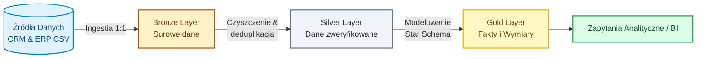

# 🏗️ SQL Data Warehouse - Medallion Architecture


> [!IMPORTANT]
> **Cel projektu:** Budowa nowoczesnej hurtowni danych w PostgreSQL w oparciu o architekturę **Medallion (Bronze -> Silver -> Gold)**. Projekt konsoliduje rozproszone dane sprzedażowe, produktowe i klienckie z systemów ERP oraz CRM w spójny model wymiarowy (*Star Schema*) gotowy do analizy biznesowej.

---

## 🎯 1. Zakres i założenia biznesowe
- **Źródła danych:** Surowe pliki CSV eksportowane z dwóch systemów źródłowych - **CRM** (dane klientów, produkty, transakcje sprzedaży) oraz **ERP** (kategorie produktów, lokalizacje, dane demograficzne).
- **Odbiorca końcowy:** Analitycy danych oraz zespoły raportowe (BI) potrzebujące jednego, zweryfikowanego źródła prawdy (*Single Source of Truth*).
- **Główny rezultat:** Automatyzacja ładowania surowych plików, eliminacja duplikatów oraz anomalii jakościowych, a następnie udostępnienie czystych tabel faktów i wymiarów.

---

## 🔄 2. Architektura przepływu danych



---

## 🛠️ 3. Stack technologiczny

| Obszar | Technologia | Zastosowanie w projekcie |
| :--- | :--- | :--- |
| **Silnik bazy danych** | PostgreSQL 19 (PL/pgSQL) | Przechowywanie warstw `bronze`, `silver`, `gold` oraz procedury ETL |
| **Narzędzia SQL** | `psql` (CLI) & pgAdmin 4 | Uruchamianie skryptów z terminala, import CSV oraz administracja bazą |
| **Modelowanie danych** | Medallion + Star Schema | Separacja surowych danych od tabel faktów i wymiarów |
| **Kontrola wersji** | Git & GitHub | Wersjonowanie skryptów DDL/DML i dokumentacji |

---

## 🏛️ 4. Opis warstw i model danych

### 🟤 Warstwa Bronze (Raw)
- Przechowuje surowe dane **1:1** w 6 tabelach źródłowych (`crm_cust_info`, `crm_prd_info`, `crm_sales_details`, `erp_px_cat_g1v2`, `erp_loc_a101`, `erp_cust_az12`) dokładnie w takiej strukturze, w jakiej pochodzą z plików CSV.
- Ładowanie realizowane jest za pomocą procedury składowanej `bronze.load_bronze()` w trybie pełnym (`TRUNCATE` + natywne `COPY`) bez modyfikacji wartości - warstwa pełni rolę audytową i pozwala odtworzyć stan źródła.
- Procedura loguje postęp oraz czas wykonania poszczególnych operacji przy użyciu `RAISE NOTICE` i `clock_timestamp()`, a blok `EXCEPTION` gwarantuje atomowość całego ładowania.

### ⚪ Warstwa Silver (Cleansed & Conformed)
- **Standaryzacja:** Usuwanie zbędnych białych znaków (`TRIM`), mapowanie skrótów na pełne nazwy biznesowe oraz ujednolicanie typów dat i liczb.
- **Deduplikacja:** Eliminacja zduplikowanych rekordów przy użyciu funkcji okna (`ROW_NUMBER() OVER(PARTITION BY ...)`).
- **Obsługa anomalii:** Korekta ujemnych lub brakujących wartości sprzedaży oraz obsługa wartości `NULL`.

### 🟡 Warstwa Gold (Business Ready - Star Schema)
- **Tabela faktów:** `gold.fact_sales` - centralna tabela przechowująca metryki sprzedaży (wartość, ilość, cena) oraz klucze obce do wymiarów.
- **Tabele wymiarów:** `gold.dim_customers` oraz `gold.dim_products` - zdenormalizowane wymiary łączące informacje z obu systemów źródłowych (CRM + ERP).

---

## ⚖️ 5. Kluczowe decyzje inżynieryjne (Engineering Trade-offs)
- **Idempotentność skryptów i procedur:** Zarówno skrypt inicjalizujący (`DROP DATABASE ... WITH (FORCE)`), jak i procedura `bronze.load_bronze()` (`TRUNCATE` + `COPY`) mogą być uruchamiane wielokrotnie bez ryzyka duplikacji danych czy błędów stanu.
- **Atomowość ładowania (Transactional Rollback):** Wykorzystanie bloku `EXCEPTION WHEN OTHERS THEN` w PL/pgSQL sprawia, że błąd podczas ładowania dowolnego pliku CSV automatycznie wycofuje wszystkie zmiany z bieżącej sesji procedury, chroniąc hurtownię przed stanem częściowego załadowania.
- **Separacja schematów w jednej bazie:** Zamiast rozbijać warstwy na osobne bazy danych, projekt wykorzystuje schematy `bronze`, `silver` i `gold` wewnątrz `data_warehouse`, co upraszcza zarządzanie uprawnieniami i krzyżowe zapytania między warstwami.
- **Skrypty pisane pod CLI (`psql`) z obsługą GUI:** Kod jest zoptymalizowany pod automatyzację w terminalu (`ON_ERROR_STOP=1`), zachowując pełną kompatybilność z narzędziami graficznymi (pgAdmin 4).

---

## 📂 6. Struktura repozytorium

```text
├── datasets/                   # Pliki źródłowe CSV (source_crm oraz source_erp)
├── docs/                       # Diagramy przepływu danych i słownik danych
├── scripts/
│   ├── init_database.sql       # Inicjalizacja bazy data_warehouse oraz schematów Medallion
│   ├── bronze/
│   │   ├── init_tables.sql     # Definicje DDL surowych tabel warstwy Bronze
│   │   └── load_bronze.sql     # Procedura bronze.load_bronze() ładująca pliki CSV
│   ├── silver/                 # Transformacje, czyszczenie i logika warstwy Silver
│   └── gold/                   # Widoki/tabele wymiarowe i faktów (Star Schema)
├── tests/                      # Zapytania weryfikujące jakość danych (Data Quality checks)
├── .gitignore
└── README.md
```

---

## 🚀 7. Jak uruchomić projekt

### 1. Inicjalizacja bazy danych i schematów (`psql`)
Skrypt `scripts/init_database.sql` jest przygotowany pod klienta terminalowego `psql` i automatycznie przełącza sesję na nowo utworzoną bazę za pomocą komendy `\c data_warehouse`:

```bash
# macOS (Postgres.app / Homebrew)
psql -d postgres -v ON_ERROR_STOP=1 -f scripts/init_database.sql

# Linux / Ubuntu Server
sudo -u postgres psql -v ON_ERROR_STOP=1 -f scripts/init_database.sql
```

> [!NOTE]
> **Uruchamianie w pgAdmin 4:** Narzędzia graficzne nie obsługują terminalowej komendy `\c`. Jeśli wykonujesz plik w pgAdminie, zakomentuj linię `-- \c data_warehouse`, uruchom **Part 1** na bazie `postgres`, a następnie otwórz **Query Tool** na bazie `data_warehouse` i wykonaj **Part 2**.

### 2. Utworzenie i zasilenie warstwy Bronze
Przed uruchomieniem ładowania upewnij się, że ścieżki do plików CSV w pliku `scripts/bronze/load_bronze.sql` wskazują lokalny katalog `datasets/` na Twojej maszynie.

```bash
# 1. Utworzenie pustych tabel warstwy Bronze
psql -d data_warehouse -v ON_ERROR_STOP=1 -f scripts/bronze/init_tables.sql

# 2. Rejestracja i wywołanie procedury ładującej dane
psql -d data_warehouse -v ON_ERROR_STOP=1 -f scripts/bronze/load_bronze.sql
```

Po zarejestrowaniu procedury kolejne przeładowania warstwy surowej można wywoływać bezpośrednio z poziomu SQL:

```sql
CALL bronze.load_bronze();
```

### 3. Transformacje Silver, Gold i testy jakości
Po załadowaniu warstwy surowej wykonaj kolejno skrypty z katalogów `scripts/silver/` oraz `scripts/gold/`, a na koniec uruchom zapytania kontrolne z folderu `tests/`, aby potwierdzić spójność kluczy i brak duplikatów.
