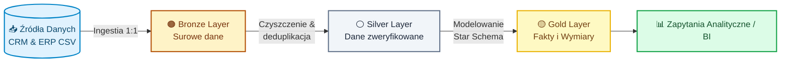

# 🏗️ SQL Data Warehouse – Medallion Architecture


> [!IMPORTANT]
> **Cel projektu:** Budowa nowoczesnej hurtowni danych w PostgreSQL w oparciu o architekturę **Medallion (Bronze $\rightarrow$ Silver $\rightarrow$ Gold)**. Projekt konsoliduje rozproszone dane sprzedażowe, produktowe i klienckie z systemów ERP oraz CRM w spójny model wymiarowy (*Star Schema*) gotowy do analizy biznesowej.

---

## 🎯 1. Zakres i założenia biznesowe
* **📥 Źródła danych:** Surowe pliki CSV eksportowane z dwóch systemów źródłowych — **CRM** (dane klientów, transakcje sprzedaży) oraz **ERP** (katalog produktów, dane demograficzne i lokalizacyjne).
* **👥 Odbiorca końcowy:** Analitycy danych oraz zespoły raportowe (BI) potrzebujące jednego, zweryfikowanego źródła prawdy (*Single Source of Truth*).
* **✨ Główny rezultat:** Automatyzacja ładowania surowych plików, eliminacja duplikatów oraz anomalii jakościowych, a następnie udostępnienie czystych tabel faktów i wymiarów.

---

## 🔄 2. Architektura przepływu danych



---

## 🛠️ 3. Stack technologiczny

| Obszar | Technologia | Zastosowanie w projekcie |
| :--- | :--- | :--- |
| **🗄️ Silnik bazy danych** | PostgreSQL 19 | Przechowywanie warstw `bronze`, `silver`, `gold` oraz przetwarzanie SQL |
| **💻 Narzędzia SQL** | `psql` (CLI) & pgAdmin 4 | Uruchamianie skryptów z terminala, import CSV oraz administracja bazą |
| **📐 Modelowanie danych** | Medallion + Star Schema | Separacja surowych danych od tabel faktów i wymiarów |
| **🔀 Kontrola wersji** | Git & GitHub | Wersjonowanie skryptów DDL/DML i dokumentacji |

---

## 🏛️ 4. Opis warstw i model danych

### 🟤 Warstwa Bronze (Raw)
* Przechowuje surowe dane **1:1** dokładnie w takiej strukturze, w jakiej pochodzą z plików źródłowych CRM i ERP.
* Ładowanie realizowane w trybie pełnym (`TRUNCATE` + ponowny import) bez żadnych modyfikacji wartości — warstwa pełni rolę audytową i pozwala odtworzyć stan źródła.

### ⚪ Warstwa Silver (Cleansed & Conformed)
* **🧹 Standaryzacja:** Usuwanie zbędnych białych znaków (`TRIM`), mapowanie skrótów na pełne nazwy biznesowe oraz ujednolicanie typów dat i liczb.
* **👯 Deduplikacja:** Eliminacja zduplikowanych rekordów klientów przy użyciu funkcji okna (`ROW_NUMBER() OVER(PARTITION BY ...)`).
* **🛡️ Obsługa anomalii:** Korekta ujemnych lub brakujących wartości sprzedaży oraz obsługa wartości `NULL`.

### 🟡 Warstwa Gold (Business Ready — Star Schema)
* **📈 Tabela faktów:** `gold.fact_sales` — centralna tabela przechowująca metryki sprzedaży (wartość, ilość, cena) oraz klucze obce do wymiarów.
* **🏷️ Tabele wymiarów:** `gold.dim_customers` oraz `gold.dim_products` — zdenormalizowane wymiary łączące informacje z obu systemów źródłowych (CRM + ERP).

---

## ⚖️ 5. Kluczowe decyzje inżynieryjne (Engineering Trade-offs)
* **🔁 Idempotentność skryptów:** Zarówno skrypt inicjalizujący (`DROP DATABASE ... WITH (FORCE)`), jak i procedury ładowania warstw można uruchamiać wielokrotnie bez ryzyka duplikacji danych czy błędów stanu.
* **🧱 Separacja schematów w jednej bazie:** Zamiast rozbijać warstwy na osobne bazy danych, projekt wykorzystuje schematy `bronze`, `silver` i `gold` wewnątrz `data_warehouse`, co upraszcza zarządzanie uprawnieniami i krzyżowe zapytania między warstwami.
* **🖥️ Skrypty pisane pod CLI (`psql`) z obsługą GUI:** Kod jest zoptymalizowany pod automatyzację w terminalu (`ON_ERROR_STOP=1`), zachowując pełną kompatybilność z narzędziami graficznymi (pgAdmin 4).

---

## 📂 6. Struktura repozytorium

```text
├── 📦 datasets/                # Pliki źródłowe CSV (CRM oraz ERP)
├── 📐 docs/                    # Diagramy przepływu danych i słownik danych
├── 📜 scripts/
│   ├── init_database.sql       # Inicjalizacja bazy data_warehouse oraz schematów Medallion
│   ├── bronze/                 # Skrypty DDL tabel surowych oraz ładowanie danych
│   ├── silver/                 # Transformacje, czyszczenie i logika warstwy Silver
│   └── gold/                   # Widoki/tabele wymiarowe i faktów (Star Schema)
├── 🧪 tests/                   # Zapytania weryfikujące jakość danych (Data Quality checks)
├── 🙈 .gitignore
└── 📖 README.md
```

---

## 🚀 7. Jak uruchomić projekt

### 1. Inicjalizacja bazy danych i schematów (`psql`)
Skrypt `scripts/init_database.sql` jest przygotowany pod klienta terminalowego `psql` i automatycznie przełącza sesję na nowo utworzoną bazę za pomocą komendy `\c data_warehouse`:

```bash
# macOS (Postgres.app / Homebrew)
psql -d postgres -v ON_ERROR_STOP=1 -f scripts/init_database.sql

# Linux / Ubuntu Server
sudo -u postgres psql -v ON_ERROR_STOP=1 -f scripts/init_database.sql
```

> [!NOTE]
> **Uruchamianie w pgAdmin 4:** Narzędzia graficzne nie obsługują terminalowej komendy `\c`. Jeśli wykonujesz plik w pgAdminie, zakomentuj linię `-- \c data_warehouse`, uruchom **Part 1** na bazie `postgres`, a następnie otwórz **Query Tool** na bazie `data_warehouse` i wykonaj **Part 2**.

### 2. Budowa warstw i weryfikacja danych
Po zainicjowaniu schematów wykonaj kolejno skrypty z katalogów `scripts/bronze/`, `scripts/silver/` oraz `scripts/gold/`, a na koniec uruchom zapytania kontrolne z folderu `tests/`, aby potwierdzić spójność kluczy i brak duplikatów.

---

## 🗺️ 8. Postęp prac (Roadmap)
* [x] Konfiguracja środowiska PostgreSQL oraz inicjalizacja schematów Medallion (`scripts/init_database.sql`).
* [ ] Utworzenie tabel warstwy `bronze` i załadowanie surowych plików CRM/ERP.
* [ ] Implementacja czyszczenia, standaryzacji i deduplikacji w warstwie `silver`.
* [ ] Zbudowanie modelu gwiazdy (`fact_sales`, `dim_customers`, `dim_products`) w warstwie `gold`.
* [ ] Dodanie zestawu testów jakości danych w katalogu `tests/`.
