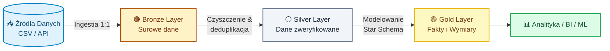

# 🏗️ [Nazwa Projektu, np. Modern Data Warehouse – Medallion Architecture]


> [!IMPORTANT]
> **Podsumowanie projektu:** Jednozdaniowy opis tego, co robi potok danych, z jakich źródeł pobiera informacje i jaką wartość biznesową dostarcza warstwa końcowa.

---

## 🎯 1. Cel biznesowy i zakres projektu
* **📥 Źródła danych:** Skąd pochodzą surowe dane (np. pliki CSV z systemów ERP/CRM, REST API giełdy).
* **👥 Odbiorca końcowy:** Kto i po co korzysta z warstwy końcowej (np. raportowanie BI, algorytm tradingowy).
* **✨ Główny rezultat:** Konsolidacja rozproszonych danych, eliminacja anomalii jakościowych i zamodelowanie ich pod szybkie zapytania analityczne.

---

## 🔄 2. Architektura przepływu danych



---

## 🛠️ 3. Stack technologiczny

| Obszar | Technologia | Zastosowanie w projekcie |
| :--- | :--- | :--- |
| **🗄️ Baza danych** | PostgreSQL 19 | Przechowywanie warstw `bronze`, `silver`, `gold` oraz logika ETL |
| **🖥️ Klient SQL** | pgAdmin 4 | Administracja bazą, import danych źródłowych, wykonywanie skryptów |
| **📐 Modelowanie** | Medallion + Star Schema | Separacja surowych danych od tabel faktów i wymiarów |
| **🔀 Kontrola wersji** | Git & GitHub | Wersjonowanie skryptów DDL/DML i dokumentacji |

---

## 🏛️ 4. Opis warstw i model danych

### 🟤 Warstwa Bronze (Raw)
* Przechowuje surowe dane **1:1** dokładnie w takiej postaci, w jakiej przyszły ze źródła (`TRUNCATE` + pełny załadunek).
* Brak transformacji biznesowych — służy jako punkt odniesienia i audytu.

### ⚪ Warstwa Silver (Cleansed & Conformed)
* **🧹 Czyszczenie jakościowe:** Usunięcie białych znaków (`TRIM`), obsługa wartości `NULL`, standaryzacja formatów dat i kodów.
* **👯 Deduplikacja:** Odfiltrowanie duplikatów przy użyciu funkcji okna (`ROW_NUMBER() OVER(PARTITION BY ...)`).
* **🛡️ Walidacja:** Odrzucenie lub oznaczenie rekordów z błędnymi wartościami.

### 🟡 Warstwa Gold (Business Ready — Star Schema)
* **📈 Tabele faktów:** `gold.fact_sales` *(metryki ilościowe, klucze obce do wymiarów)*.
* **🏷️ Tabele wymiarów:** `gold.dim_customers`, `gold.dim_products`, `gold.dim_date`.

---

## ⚖️ 5. Kluczowe decyzje inżynieryjne (Engineering Trade-offs)
* **🔁 Idempotentność ładowania:** Wielokrotne uruchomienie skryptów ładujących daje zawsze ten sam stan docelowy bez duplikowania rekordów.
* **🧱 Separacja schematów:** Podział na `bronze`, `silver` i `gold` w ramach jednej bazy izoluje surowe, niezweryfikowane dane od warstwy raportowej.
* **🧪 Wbudowane testy jakości:** Każda transformacja posiada osobny zestaw zapytań weryfikujących spójność kluczy i kompletność danych.

---

## 📂 6. Struktura repozytorium

```text
├── 📦 datasets/                # Surowe pliki źródłowe (lub skrypty pobierające)
├── 📐 docs/                    # Diagramy ERD, słownik danych
├── 📜 scripts/
│   ├── 01_init_database.sql    # Inicjalizacja bazy i schematów (bronze, silver, gold)
│   ├── 02_bronze/              # DDL tabel surowych oraz procedury ładowania
│   ├── 03_silver/              # Transformacje, czyszczenie i procedury Silver
│   └── 04_gold/                # Tabele/widoki wymiarowe i faktów (Star Schema)
├── 🧪 tests/                   # Zapytania sprawdzające jakość danych (Data Quality)
├── 🔐 .env.example             # Szablon zmiennych środowiskowych (bez haseł)
├── 🙈 .gitignore
└── 📖 README.md
```

---

## 🚀 7. Jak uruchomić projekt lokalnie

1. **Sklonuj repozytorium:**
   ```bash
   git clone [https://github.com/twoj-nick/nazwa-repozytorium.git](https://github.com/twoj-nick/nazwa-repozytorium.git)
   cd nazwa-repozytorium
   ```
2. **Zainicjuj bazę danych:**
   * Uruchom lokalny serwer PostgreSQL (np. przez Postgres.app).
   * Wykonaj sekcję 1 pliku `scripts/01_init_database.sql` z poziomu bazy `postgres`, a następnie sekcję 2 wewnątrz bazy `data_warehouse`.

> [!NOTE]
> PostgreSQL nie obsługuje polecenia `USE` znanego z MS SQL Servera — przed uruchomieniem sekcji 2 upewnij się, że otworzyłeś **Query Tool** bezpośrednio na bazie `data_warehouse`.

3. **Załaduj i przetwórz dane:**
   * Uruchom kolejno skrypty z katalogów `02_bronze`, `03_silver` oraz `04_gold`.
4. **Zweryfikuj jakość danych:**
   * Odpal zapytania z folderu `tests/`, aby potwierdzić brak duplikatów i osieroconych kluczy w warstwie `gold`.

---

## 🗺️ 8. Planowany rozwój (Roadmap)
* [x] Konfiguracja środowiska lokalnego PostgreSQL oraz architektury schematów Medallion.
* [ ] Implementacja tabel warstwy `bronze` oraz zasilenie danymi źródłowymi.
* [ ] Budowa logiki czyszczenia i deduplikacji w warstwie `silver`.
* [ ] Zamodelowanie schematu gwiazdy w warstwie `gold` i dodanie testów w `tests/`.
* [ ] Przeniesienie architektury na stos **Python + PySpark + chmura** w kolejnym projekcie.
