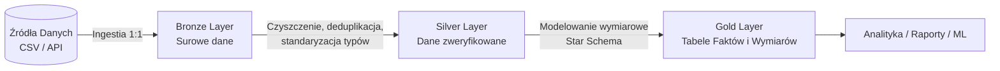

# [Nazwa Projektu, np. Modern Data Warehouse – Medallion Architecture]

> Jednozdaniowe podsumowanie: co robi projekt, z jakich źródeł pobiera dane i jaką wartość biznesową dostarcza.


---

## 1. Cel biznesowy i zakres projektu
* **Źródła danych:** Skąd pochodzą surowe dane (np. pliki CSV z systemów ERP/CRM, REST API giełdy).
* **Odbiorca końcowy:** Kto i po co korzysta z warstwy końcowej (np. raportowanie BI, algorytm tradingowy).
* **Główny rezultat:** Konsolidacja rozproszonych danych, oczyszczenie anomalii i zamodelowanie ich pod szybkie zapytania analityczne.

---

## 2. Architektura przepływu danych



---

## 3. Stack technologiczny
* **Baza danych / Silnik przetwarzania:** PostgreSQL 19 (docelowo Python + PySpark / chmura)
* **Narzędzia i środowisko:** pgAdmin 4, Git
* **Modelowanie danych:** Architektura Medallion, Schemat Gwiazdy (Star Schema)

---

## 4. Opis warstw i model danych

### Warstwa Bronze (Raw)
* Przechowuje surowe dane 1:1 dokładnie w takiej postaci, w jakiej przyszły ze źródła (`TRUNCATE` + pełny załadunek).
* Brak transformacji biznesowych — służy jako punkt odniesienia i audytu.

### Warstwa Silver (Cleansed & Conformed)
* **Czyszczenie jakościowe:** Usunięcie białych znaków (`TRIM`), obsługa `NULL`, standaryzacja formatów dat i kodów.
* **Deduplikacja:** Odfiltrowanie duplikatów przy użyciu funkcji okna (`ROW_NUMBER() OVER(PARTITION BY ...)`).
* **Walidacja:** Odrzucenie lub oznaczenie rekordów z błędnymi wartościami.

### Warstwa Gold (Business Ready — Star Schema)
* **Tabele faktów:** `gold.fact_sales` (metryki ilościowe, klucze obce do wymiarów).
* **Tabele wymiarów:** `gold.dim_customers`, `gold.dim_products`, `gold.dim_date`.

---

## 5. Kluczowe decyzje inżynieryjne (Engineering Trade-offs)
* **Idempotentność ładowania:** Wielokrotne uruchomienie skryptów ładujących daje zawsze ten sam stan docelowy bez duplikowania rekordów.
* **Separacja schematów:** Podział na `bronze`, `silver` i `gold` w ramach jednej bazy izoluje surowe, niezweryfikowane dane od warstwy raportowej.

---

## 6. Struktura repozytorium

```text
├── datasets/               # Surowe pliki źródłowe (lub skrypty pobierające)
├── docs/                   # Diagramy ERD, słownik danych
├── scripts/
│   ├── init_database.sql    # Inicjalizacja bazy i schematów (bronze, silver, gold)
│   ├── bronze/              # DDL tabel surowych oraz procedury ładowania
│   ├── silver/              # Transformacje, czyszczenie i procedury Silver
│   └── gold/                # Tabele/widoki wymiarowe i faktów (Star Schema)
├── tests/                  # Zapytania sprawdzające jakość danych (Data Quality checks)
├── .env.example            # Szablon zmiennych środowiskowych (bez haseł)
├── .gitignore
└── README.md
```

---

## 7. Jak uruchomić projekt lokalnie

1. **Sklonuj repozytorium:**
   ```bash
   git clone [https://github.com/twoj-nick/nazwa-repozytorium.git](https://github.com/twoj-nick/nazwa-repozytorium.git)
   cd nazwa-repozytorium
   ```
2. **Zainicjuj bazę danych:**
   * Uruchom lokalny serwer PostgreSQL.
   * Wykonaj sekcję 1 pliku `scripts/01_init_database.sql` z poziomu bazy `postgres`, a następnie sekcję 2 wewnątrz bazy `data_warehouse`.
3. **Załaduj i przetwórz dane:**
   * Uruchom kolejno skrypty z katalogów `02_bronze`, `03_silver` oraz `04_gold`.
4. **Zweryfikuj jakość danych:**
   * Odpal zapytania z folderu `tests/`, aby potwierdzić brak duplikatów i osieroconych kluczy w warstwie `gold`.

---

## 8. Planowany rozwój (Roadmap)
* [ ] Dodanie zestawu testów jakości danych w katalogu `tests/`.
* [ ] Automatyzacja przepływu między warstwami za pomocą procedur składowanych.
* [ ] Przeniesienie podobnej architektury na stos Python + PySpark + chmura w kolejnym projekcie.
